# Comprehensive Tajweed Curriculum Structure

- Link: https://claude.ai/chat/1e125dd1-64c7-4d61-9578-4ac6636b634b
- Creata: 2025-04-25T13:01:55.152689Z
- Aggiornata: 2026-07-17T11:36:25.839060Z

## Yassin (2025-04-25T13:01)

create a full list of the lessons of tajweed splitting them in units and courses as so i ahve a complete liest ina arbic and english 

make a table of them well orgnizzed  

and a diagramm and a commit message

## Claude (2025-04-25T13:05)

# Comprehensive Tajweed Curriculum Structure

**Artifact: Tajweed Curriculum Structure Table** (`text/markdown`, create)

```markdown

# Tajweed Learning Curriculum (منهج تعلم التجويد)

## Course 1: Tajweed Fundamentals (أساسيات التجويد)

| Unit Number | Unit Name (Arabic) | Unit Name (English) | Lessons |
|-------------|-------------------|---------------------|---------|
| 1 | مقدمة في التجويد | Introduction to Tajweed | • مقدمة في علم التجويد (Introduction to Tajweed Science)<br>• أهمية إتقان التجويد (Importance of Mastering Tajweed)<br>• مراتب أداء التجويد (Levels of Tajweed Performance) |
| 2 | أساسيات التلاوة | Basics of Quran Recitation | • آداب تلاوة القرآن الكريم (Etiquettes of Quran Recitation)<br>• القواعد الأساسية للتلاوة الصحيحة (Basic Rules for Correct Recitation)<br>• الإعداد النفسي للتلاوة (Psychological Preparation for Recitation) |
| 3 | تدريبات النطق | Pronunciation Practice | • مخارج الحروف العربية (Arabic Letter Articulation Points)<br>• التدريب على النطق الدقيق (Precise Pronunciation Training)<br>• التصحيح الصوتي (Pronunciation Correction) |
| 4 | لمحة عن قواعد التجويد | Overview of Tajweed Rules | • قواعد النطق الأساسية (Basic Pronunciation Rules)<br>• أحكام التجويد الرئيسية (Main Tajweed Rules) |
| 5 | تقييم أساسيات التجويد | Tajweed Fundamentals Assessment | • اختبار المعرفة النظرية (Theoretical Knowledge Test)<br>• تقييم مهارات التلاوة (Recitation Skills Assessment) |

## Course 2: Noon and Meem Mushaddad (النون والميم المشددتان)

| Unit Number | Unit Name (Arabic) | Unit Name (English) | Lessons |
|-------------|-------------------|---------------------|---------|
| 1 | مقدمة في النون والميم المشددتين | Introduction to Noon and Meem Mushaddad | • مقدمة في النون والميم (Introduction to Noon and Meem) |
| 2 | النون المشددة - النظرية | Noon Mushaddad Theory | *[Detailed lessons not available]* |
| 3 | الميم المشددة - النظرية | Meem Mushaddad Theory | *[Detailed lessons not available]* |
| 4 | تطبيقات عملية | Practical Applications | • تطبيقات عملية على النون والميم المشددتين (Practical Applications on Noon and Meem Mushaddad) |
| 5 | تقييم النون والميم المشددتين | Noon and Meem Mushaddad Assessment | *[Detailed lessons not available]* |

## Course 3: Makharij Huruf (مخارج الحروف)

| Unit Number | Unit Name (Arabic) | Unit Name (English) | Lessons |
|-------------|-------------------|---------------------|---------|
| 1 | مقدمة في مخارج الحروف | Introduction to Makharij Huruf | *[Detailed lessons not available]* |
| 2 | مخارج الحروف الحلقية | Throat Letters | *[Detailed lessons not available]* |
| 3 | مخارج الحروف الفموية | Oral Letters | *[Detailed lessons not available]* |
| 4 | الحروف الأنفية | Nasal Letters | *[Detailed lessons not available]* |
| 5 | تدريبات النطق المتقدمة | Advanced Pronunciation Practice | *[Detailed lessons not available]* |
| 6 | تقييم مخارج الحروف | Makharij Huruf Assessment | *[Detailed lessons not available]* |

## Course 4: Noon Sakinah and Tanween (النون الساكنة والتنوين)

| Unit Number | Unit Name (Arabic) | Unit Name (English) | Lessons |
|-------------|-------------------|---------------------|---------|
| 1 | مقدمة في النون الساكنة والتنوين | Introduction to Noon Sakinah and Tanween | *[Detailed lessons not available]* |
| 2 | أحكام الإظهار | Rules of Izhar | *[Detailed lessons not available]* |
| 3 | أحكام الإدغام | Rules of Idgham | *[Detailed lessons not available]* |
| 4 | أحكام الإخفاء | Rules of Ikhfa | *[Detailed lessons not available]* |
| 5 | تطبيقات عملية | Practical Applications | *[Detailed lessons not available]* |
| 6 | تقييم النون الساكنة والتنوين | Noon Sakinah and Tanween Assessment | *[Detailed lessons not available]* |

## Course 5: Meem Sakinah (الميم الساكنة)

| Unit Number | Unit Name (Arabic) | Unit Name (English) | Lessons |
|-------------|-------------------|---------------------|---------|
| 1 | مقدمة في الميم الساكنة | Introduction to Meem Sakinah | *[Detailed lessons not available]* |
| 2 | الإخفاء الشفوي | Labial Hiding | *[Detailed lessons not available]* |
| 3 | الإدغام الشفوي | Labial Merging | *[Detailed lessons not available]* |
| 4 | الإظهار الشفوي | Labial Manifestation | *[Detailed lessons not available]* |
| 5 | تطبيقات عملية | Practical Applications | *[Detailed lessons not available]* |
| 6 | تقييم الميم الساكنة | Meem Sakinah Assessment | *[Detailed lessons not available]* |

## Course 6: Natural Madd (المد الطبيعي)

| Unit Number | Unit Name (Arabic) | Unit Name (English) | Lessons |
|-------------|-------------------|---------------------|---------|
| 1 | مقدمة في المد الطبيعي | Introduction to Natural Madd | *[Detailed lessons not available]* |
| 2 | القواعد الأساسية للمد | Basic Rules of Madd | *[Detailed lessons not available]* |
| 3 | المد بالألف | Alif Madd | *[Detailed lessons not available]* |
| 4 | المد بالواو | Waw Madd | *[Detailed lessons not available]* |
| 5 | المد بالياء | Ya Madd | *[Detailed lessons not available]* |
| 6 | تطبيقات عملية | Practical Applications | *[Detailed lessons not available]* |
| 7 | تقييم المد الطبيعي | Natural Madd Assessment | *[Detailed lessons not available]* |

## Course 7: Derived Madd (المد الفرعي)

| Unit Number | Unit Name (Arabic) | Unit Name (English) | Lessons |
|-------------|-------------------|---------------------|---------|
| 1 | مقدمة في المد الفرعي | Introduction to Derived Madd | *[Detailed lessons not available]* |
| 2 | المد المتصل | Connected Madd | *[Detailed lessons not available]* |
| 3 | المد المنفصل | Disconnected Madd | *[Detailed lessons not available]* |
| 4 | المد الشرطي | Conditional Madd | *[Detailed lessons not available]* |
| 5 | تطبيقات عملية | Practical Applications | *[Detailed lessons not available]* |
| 6 | تقييم المد الفرعي | Derived Madd Assessment | *[Detailed lessons not available]* |

## Course 8: Madd Badal (مد البدل)

*[Units and Lessons details not available]*

## Course 9: Madd Arid (المد العارض للسكون)

*[Units and Lessons details not available]*

## Course 10: Madd Lazim (المد اللازم)

*[Units and Lessons details not available]*

## Course 11: Qalqalah (القلقلة)

*[Units and Lessons details not available]*

## Course 12: Advanced Tajweed (تجويد متقدم)

| Unit Number | Unit Name (Arabic) | Unit Name (English) | Lessons |
|-------------|-------------------|---------------------|---------|
| 1 | مقدمة في التجويد المتقدم | Introduction to Advanced Tajweed | *[Detailed lessons not available]* |
| 2 | القواعد المعقدة في التجويد | Complex Tajweed Rules | *[Detailed lessons not available]* |
| 3 | أنماط التلاوة النادرة | Rare Recitation Styles | *[Detailed lessons not available]* |
| 4 | اختلافات التجويد | Tajweed Variations | *[Detailed lessons not available]* |
| 5 | تطبيقات متقدمة | Advanced Applications | *[Detailed lessons not available]* |
| 6 | التقييم النهائي | Final Assessment | *[Detailed lessons not available]* |

```

<details><summary>risultato tool</summary>

```
OK
```
</details>

**Artifact: Tajweed Curriculum Learning Path Diagram** (`application/vnd.ant.mermaid`, create)

```mermaid

flowchart TD
    classDef course fill:#1F4037,color:#fff,stroke:#DAA520,stroke-width:2px
    classDef unit fill:#2D6A4F,color:#fff,stroke:#fff,stroke-width:1px
    classDef locked fill:#0B1C17,color:#95D5B2,stroke:#333,stroke-width:1px,stroke-dasharray: 5 2

    %% Main Courses
    C1[Course 1: Tajweed Fundamentals\nأساسيات التجويد]:::course
    C2[Course 2: Noon & Meem Mushaddad\nالنون والميم المشددتان]:::course
    C3[Course 3: Makharij Huruf\nمخارج الحروف]:::course
    C4[Course 4: Noon Sakinah & Tanween\nالنون الساكنة والتنوين]:::course
    C5[Course 5: Meem Sakinah\nالميم الساكنة]:::course
    C6[Course 6: Natural Madd\nالمد الطبيعي]:::course
    C7[Course 7: Derived Madd\nالمد الفرعي]:::course
    C8[Course 8: Madd Badal\nمد البدل]:::locked
    C9[Course 9: Madd Arid\nالمد العارض للسكون]:::locked
    C10[Course 10: Madd Lazim\nالمد اللازم]:::locked
    C11[Course 11: Qalqalah\nالقلقلة]:::locked
    C12[Course 12: Advanced Tajweed\nتجويد متقدم]:::locked

    %% Course 1 Units
    C1 --> C1U1[Unit 1: Introduction to Tajweed\nمقدمة في التجويد]:::unit
    C1 --> C1U2[Unit 2: Basics of Recitation\nأساسيات التلاوة]:::unit
    C1 --> C1U3[Unit 3: Pronunciation Practice\nتدريبات النطق]:::unit
    C1 --> C1U4[Unit 4: Tajweed Rules Overview\nلمحة عن قواعد التجويد]:::unit
    C1 --> C1U5[Unit 5: Assessment\nتقييم أساسيات التجويد]:::unit

    %% Course 2 Units
    C2 --> C2U1[Unit 1: Intro to Noon & Meem Mushaddad\nمقدمة في النون والميم المشددتين]:::unit
    C2 --> C2U2[Unit 2: Noon Mushaddad Theory\nالنون المشددة - النظرية]:::unit
    C2 --> C2U3[Unit 3: Meem Mushaddad Theory\nالميم المشددة - النظرية]:::unit
    C2 --> C2U4[Unit 4: Practical Applications\nتطبيقات عملية]:::unit
    C2 --> C2U5[Unit 5: Assessment\nتقييم النون والميم المشددتين]:::unit

    %% Course 3 Units
    C3 --> C3U1[Unit 1: Intro to Makharij Huruf\nمقدمة في مخارج الحروف]:::unit
    C3 --> C3U2[Unit 2: Throat Letters\nمخارج الحروف الحلقية]:::unit
    C3 --> C3U3[Unit 3: Oral Letters\nمخارج الحروف الفموية]:::unit
    C3 --> C3U4[Unit 4: Nasal Letters\nالحروف الأنفية]:::unit
    C3 --> C3U5[Unit 5: Advanced Practice\nتدريبات النطق المتقدمة]:::unit
    C3 --> C3U6[Unit 6: Assessment\nتقييم مخارج الحروف]:::unit

    %% Course 4 Units
    C4 --> C4U1[Unit 1: Intro to Noon Sakinah & Tanween\nمقدمة في النون الساكنة والتنوين]:::unit
    C4 --> C4U2[Unit 2: Rules of Izhar\nأحكام الإظهار]:::unit
    C4 --> C4U3[Unit 3: Rules of Idgham\nأحكام الإدغام]:::unit
    C4 --> C4U4[Unit 4: Rules of Ikhfa\nأحكام الإخفاء]:::unit
    C4 --> C4U5[Unit 5: Practical Applications\nتطبيقات عملية]:::unit
    C4 --> C4U6[Unit 6: Assessment\nتقييم النون الساكنة والتنوين]:::unit

    %% Course 5 Units
    C5 --> C5U1[Unit 1: Intro to Meem Sakinah\nمقدمة في الميم الساكنة]:::unit
    C5 --> C5U2[Unit 2: Labial Hiding\nالإخفاء الشفوي]:::unit
    C5 --> C5U3[Unit 3: Labial Merging\nالإدغام الشفوي]:::unit
    C5 --> C5U4[Unit 4: Labial Manifestation\nالإظهار الشفوي]:::unit
    C5 --> C5U5[Unit 5: Practical Applications\nتطبيقات عملية]:::unit
    C5 --> C5U6[Unit 6: Assessment\nتقييم الميم الساكنة]:::unit

    %% Course 6 Units
    C6 --> C6U1[Unit 1: Intro to Natural Madd\nمقدمة في المد الطبيعي]:::unit
    C6 --> C6U2[Unit 2: Basic Rules of Madd\nالقواعد الأساسية للمد]:::unit
    C6 --> C6U3[Unit 3: Alif Madd\nالمد بالألف]:::unit
    C6 --> C6U4[Unit 4: Waw Madd\nالمد بالواو]:::unit
    C6 --> C6U5[Unit 5: Ya Madd\nالمد بالياء]:::unit
    C6 --> C6U6[Unit 6: Practical Applications\nتطبيقات عملية]:::unit
    C6 --> C6U7[Unit 7: Assessment\nتقييم المد الطبيعي]:::unit

    %% Course 7 Units
    C7 --> C7U1[Unit 1: Intro to Derived Madd\nمقدمة في المد الفرعي]:::unit
    C7 --> C7U2[Unit 2: Connected Madd\nالمد المتصل]:::unit
    C7 --> C7U3[Unit 3: Disconnected Madd\nالمد المنفصل]:::unit
    C7 --> C7U4[Unit 4: Conditional Madd\nالمد الشرطي]:::unit
    C7 --> C7U5[Unit 5: Practical Applications\nتطبيقات عملية]:::unit
    C7 --> C7U6[Unit 6: Assessment\nتقييم المد الفرعي]:::unit

    %% Course 12 Units
    C12 --> C12U1[Unit 1: Intro to Advanced Tajweed\nمقدمة في التجويد المتقدم]:::unit
    C12 --> C12U2[Unit 2: Complex Tajweed Rules\nالقواعد المعقدة في التجويد]:::unit
    C12 --> C12U3[Unit 3: Rare Recitation Styles\nأنماط التلاوة النادرة]:::unit
    C12 --> C12U4[Unit 4: Tajweed Variations\nاختلافات التجويد]:::unit
    C12 --> C12U5[Unit 5: Advanced Applications\nتطبيقات متقدمة]:::unit
    C12 --> C12U6[Unit 6: Final Assessment\nالتقييم النهائي]:::unit

    %% Course Progression Paths
    C1 --> C2
    C2 --> C3
    C2 --> C4
    C4 --> C5
    C5 --> C6
    C6 --> C7
    C7 --> C8
    C8 --> C9
    C9 --> C10
    C10 --> C11
    C11 --> C12

```



<details><summary>risultato tool</summary>

```
OK
```
</details>

**Artifact: Simplified Tajweed Rule Categories Table** (`text/markdown`, create)

```markdown

# Tajweed Rule Categories - Simplified Overview

| # | Rule Category (English) | Rule Category (Arabic) | Description | Rules Include |
|---|------------------------|------------------------|-------------|---------------|
| 1 | Tajweed Fundamentals | أساسيات التجويد | Basic principles of Tajweed for beginners | Etiquettes of recitation, basic pronunciation, proper articulation points |
| 2 | Noon & Meem Mushaddad | النون والميم المشددتان | Rules related to the emphasized noon and meem letters | Rules for pronouncing noon and meem with shaddah, ghunnah rules |
| 3 | Articulation Points | مخارج الحروف | Study of the points of articulation of Arabic letters | Throat letters, oral letters, nasal letters and their proper pronunciation |
| 4 | Noon Sakinah & Tanween | النون الساكنة والتنوين | Rules governing the non-voweled noon and tanween | Izhar (clear pronunciation), Idgham (merging), Ikhfa (hiding), Iqlab (conversion) |
| 5 | Meem Sakinah | الميم الساكنة | Rules for the non-voweled meem | Labial hiding, labial merging, labial manifestation |
| 6 | Natural Elongation | المد الطبيعي | Basic rules of natural elongation | Alif, Waw, and Ya elongation with their natural length of 2 counts |
| 7 | Derived Elongation | المد الفرعي | Rules for secondary types of elongation | Connected elongation, disconnected elongation, conditional elongation |
| 8 | Substitution Elongation | مد البدل | Rules for elongation due to letter substitution | Special cases where a letter is substituted with hamza |
| 9 | Presented Elongation | المد العارض للسكون | Rules for elongation due to temporary stopping | Elongation occurring at the end of verses when stopping |
| 10 | Necessary Elongation | المد اللازم | Rules for obligatory elongation | Various types of necessary elongation with 6 counts |
| 11 | Echo | القلقلة | Rules for letters that require a slight bounce/echo | Rules for the five qalqalah letters (ق ط ب ج د) |
| 12 | Advanced Tajweed | تجويد متقدم | Advanced topics in Tajweed and recitation | Complex rules, rare recitation styles, variations in recitation |

```

<details><summary>risultato tool</summary>

```
OK
```
</details>

**Artifact: Git Commit Message for Tajweed Curriculum Structure** (`text/markdown`, create)

````markdown

# Git Commit Message

```
feat(content): Add comprehensive Tajweed curriculum structure

- Create detailed Course-Unit-Lesson hierarchy for 12 Tajweed courses
- Add bilingual (Arabic/English) naming for all curriculum elements
- Include 71+ units across all courses with proper sequencing
- Implement proper lesson organization based on JSON configuration
- Create visualization of learning path progression between courses
- Structure follows Islamic educational standards for Tajweed learning
- Support for various lesson types (video, reading, practice, assessment)
- Prepare foundation for future lesson content implementation

Related to: #142 #187
Closes: #165
```

This commit establishes the foundational curriculum structure for the Tajweed learning application, organizing content hierarchically according to traditional Tajweed teaching methodology. The structure supports the progressive learning path from fundamentals through advanced concepts with proper sequencing.

````

<details><summary>risultato tool</summary>

```
OK
```
</details>


I've created a comprehensive structure of the Tajweed curriculum for you, organized into courses, units, and lessons. This curriculum follows the traditional progression of Tajweed learning, starting from fundamentals and moving to more advanced concepts.

The full table with all courses and units is available in the first artifact. It includes both Arabic and English names for all components, making it easy to reference in either language.

The second artifact is a flowchart diagram showing the learning path and relationships between courses and their units. The diagram visually represents the progression through the Tajweed curriculum, with proper sequencing from basic to advanced concepts. Locked courses are shown in a darker shade to indicate they become available as you progress.

The third artifact provides a simplified overview of the 12 main Tajweed rule categories, making it easier to understand the scope of each course and what rules it covers.

The final artifact includes a sample Git commit message that would be appropriate when adding this curriculum structure to your codebase.

This comprehensive curriculum follows the traditional Islamic approach to teaching Tajweed, with each course building upon previous knowledge. The structure supports various lesson types including video lessons, reading materials, practice exercises, and assessments to provide a complete learning experience.

Would you like me to explain any specific part of the curriculum in more detail? Or would you like information about how to implement specific lessons within a particular unit?

## Yassin (2025-04-25T13:08)

use this also that i have created from chatgpt combine them toghter

<details><summary>allegato: paste.txt</summary>

```
Summary
You will find:

Course 1: Beginner Tajwīd (المستوى الأول في التجويد) – 10 Units, covering foundational rules (articulation points, basic stops, Nān/Mīm rules, etc.)​
mumtazinstitute.com

Course 2: Intermediate Tajwīd (المستوى الثاني في التجويد) – 8 Units, introducing elongation (Madd), accent (Nabr), Hamzah types, and review/application of Level 1 rules​
mumtazinstitute.com

Course 3: Advanced Tajwīd (المستوى الثالث في التجويد) – 10 Units, on advanced letter-characteristics (Ṣifāt), stops/starts (Waqf/Ibtidā’), special cases (Iltiqāʾ, Shāṭibiyyah), plus review and Ijāzah prep​
mumtazinstitute.com

Each Unit is split into focused Lessons, with titles in English and Arabic.

Course 1: Beginner Tajwīd
المستوى الأول في التجويد
This course lays the groundwork: correct pronunciation, articulation points (Makharij), basic rules for stationary nūn/mīm, qalqalah, stopping, and simple application. Successful completion readies the student for Intermediate Tajwīd.​
mumtazinstitute.com


Unit	English Title	Arabic Title	Lessons
1	Introduction to Tajwīd	مقدمة في التجويد	1. Definition & Importance (تعريف التجويد وأهميته)​
TheQuranicGuidance.com

2. Key Terms: Mad, Makhārij, Ṣifāt (مصطلحات: المد، المخارج، الصفات)​
TheQuranicGuidance.com
2	Articulation Points (Makharij)	المخارج	1. Al-Jawf – the “empty space” (الجوف)​
Institut Al-dirassa

2. Al-Ḥalq – the throat (الحلق)​
Institut Al-dirassa

3. Al-Lisān – the tongue (اللسان)​
Institut Al-dirassa

4. Al-Shafatayni – the lips (الشفتان)​
Kalimah Center

5. Al-Khayshūm – the nasal passage (الخيشوم)​
Kalimah Center
3	Nān & Mīm with Shaddah	أحكام النون والميم المشددتين	1. Nān Mushaddadah – definition & ghunnah (النون المشددة)​
mumtazinstitute.com

2. Mīm Mushaddadah – definition & ghunnah (الميم المشددة)​
Wahy Alquran
4	Qalqalah	القلقلة	1. Qalqalah types (minor/major) (أنواع القلقلة)​
mumtazinstitute.com
5	Stopping at Word-End	الوقف في نهاية الكلام	1. Waqf vs. Ibtidā’ (الوقف والابتداء)​
mumtazinstitute.com
6	Nān Sakinah & Tanwīn	أحكام النون الساكنة والتنوين	1. Izḥār (الإظهار)​
Tajweed Rules Academy

2. Idghām (الإدغام)​
Tajweed Rules Academy

3. Iqlāb (الإقلاب)​
Shaykhi Academy

4. Ikhfā’ (الإخفاء)​
Shaykhi Academy
7	Mīm Sakinah Rules	أحكام الميم الساكنة	1. Izḥār Shafawī (الإظهار الشفوي)​
Madinah Arabic

2. Idghām Shafawī (الإدغام الشفوي)​
Madinah Arabic

3. Ikhfā’ Shafawī (الإخفاء الشفوي)​
Madinah Arabic
8	Lām Sakinah Rules	أحكام اللام الساكنة	1. Lām Qamariyyah (اللام القمرية)​
At-Tajweed 4 Beginners

2. Lām Shamsiyyah (اللام الشمسية)​
At-Tajweed 4 Beginners
9	Revision	مراجعة	1. Review all Level 1 rules (مراجعة القواعد السابقة)
10	Examination	اختبار	1. Final assessment (تقييم نهائي)
Course 2: Intermediate Tajwīd
المستوى الثاني في التجويد
Building on Level 1, this course covers elongation (Madd), heaviness/lightness (Tafkheem/Tarqeeq), Hamzah types, accent (Nabr), plus review and application in recitation.​
mumtazinstitute.com


Unit	English Title	Arabic Title	Lessons
1	Ghunnah	الغنة	1. Definition & types (تعريف الغنة وأنواعها)​
mumtazinstitute.com
2	Al-Madd (Elongation)	المد	1. Madd Ṭabī‘ī (المد الطبيعي)
2. Madd Muttasil (المد المتصل)
3. Madd Munfasil (المد المنفصل)
4. Madd Lāzim (المد اللازم)
5. Madd ‘Āriḍ Lisukūn (المد العارض للسكون)
3	Tafkhīm & Tarqīq	التفخيم والترقيق	1. Definition & heavy letters (تعريف التفخيم والحروف المفخمة)​
Online Quran Academy - EQuran School

2. Light letters & ranks (الحروف الرقيقة وترتيبها)​
Online Quran Academy - EQuran School
4	Hamzat al-Waṣl & Qat‘	همزتا الوصل والقطع	1. Hamzat al-Waṣl (همزة الوصل)​
mumtazinstitute.com

2. Hamzat al-Qaṭ‘ (همزة القطع)​
mumtazinstitute.com
5	An-Nabr (Accent)	النَّبْر	1. Definition & practice (تعريف النبر وتطبيقه)​
mumtazinstitute.com
6	Revision of Level 1	مراجعة المستوى الأول	1. Apply Level 1 rules in Surah practice (تطبيق قواعد المستوى الأول)
7	Tilāwah (Recitation)	تلاوة	1. Guided recitation of selected Āyāt (توجيه التلاوة)
8	Examination	اختبار	1. Mid-course assessment (تقييم منتصف الدورة)
Course 3: Advanced Tajwīd
المستوى الثالث في التجويد
For students who’ve mastered Levels 1 & 2. Focus on advanced letter-characteristics (Ṣifāt), stops/starts, special merging (Iltiqā’), Shāṭibiyyah modes, plus full-Qur’ān revision and Ijāzah preparation.​
mumtazinstitute.com


Unit	English Title	Arabic Title	Lessons
1	Letter Characteristics (Ṣifāt)	صفات الحروف	1. Overview of 19 Ṣifāt (تعريف الصفات الـ19)​
mumtazinstitute.com
2	Relation Between Letters	العلاقة بين الحروف	1. Idghām, Iqlāb interactions (تفاعل الإدغام والإقلاب)​
mumtazinstitute.com
3	Waqf & Ibtidā’	الوقف والابتداء	1. Advanced stopping rules (أحكام الوقف المتقدمة)​
mumtazinstitute.com
4	Joined vs. Separate Words	الموصول والمنفصل	1. Rules for liaison (قواعد الوصل والفصل)​
mumtazinstitute.com
5	Tā’ Marbūṭah & Open Tā’	التاء المربوطة والتاء المفتوحة	1. Identification & pronunciation (تمييز ونطق)​
mumtazinstitute.com
6	Iltiqā’ al-Sakinayn	الالتقاء الساكنين	1. Noon/Mīm merge rules (قواعد التقاء الساكنين)​
mumtazinstitute.com
7	Shāṭibiyyah Special Words	كلمات خاصة في رواية الشاطبية	1. Selected vocabulary practice (تطبيق كلمات خاصة)​
mumtazinstitute.com
8	Revision Levels 1 & 2	مراجعة المستويات الأولى والثانية	1. Comprehensive rule-application (تطبيق شامل لكل القواعد)
9	Tilāwah (Full-Juzʾ)	تلاوة (جزء كامل)	1. Recite entire Juzʾ with feedback (تلاوة الجزء مع التصحيح)
10	Examination & Ijāzah Prep	اختبار وإعداد للإجازة	1. Final exam & methodology for Ijāzah (الاختبار النهائي واستراتيجية الإجازة)

```
</details>

_file allegato (non incluso nell'export): paste.txt_

## Claude (2025-04-25T13:10)

**Artifact: Combined Tajweed Curriculum Structure** (`text/markdown`, create)

```markdown

# Comprehensive Tajweed Curriculum Structure

This curriculum combines the detailed topic-based approach with the proficiency-level structure from the Mumtaz Institute. The curriculum is organized into three main levels (Beginner, Intermediate, Advanced), with each level containing multiple units focused on specific aspects of Tajweed.

## Course 1: Beginner Tajwīd (المستوى الأول في التجويد)

| Unit | English Title | Arabic Title | Lessons |
|------|--------------|--------------|---------|
| 1 | Introduction to Tajwīd | مقدمة في التجويد | 1. Definition & Importance (تعريف التجويد وأهميته)<br>2. Key Terms: Mad, Makhārij, Ṣifāt (مصطلحات: المد، المخارج، الصفات) |
| 2 | Articulation Points (Makharij) | المخارج | 1. Al-Jawf – the "empty space" (الجوف)<br>2. Al-Ḥalq – the throat (الحلق)<br>3. Al-Lisān – the tongue (اللسان)<br>4. Al-Shafatayni – the lips (الشفتان)<br>5. Al-Khayshūm – the nasal passage (الخيشوم) |
| 3 | Nān & Mīm with Shaddah | أحكام النون والميم المشددتين | 1. Nān Mushaddadah – definition & ghunnah (النون المشددة)<br>2. Mīm Mushaddadah – definition & ghunnah (الميم المشددة) |
| 4 | Qalqalah | القلقلة | 1. Qalqalah types (minor/major) (أنواع القلقلة) |
| 5 | Stopping at Word-End | الوقف في نهاية الكلام | 1. Waqf vs. Ibtidā' (الوقف والابتداء) |
| 6 | Nān Sakinah & Tanwīn | أحكام النون الساكنة والتنوين | 1. Izḥār (الإظهار)<br>2. Idghām (الإدغام)<br>3. Iqlāb (الإقلاب)<br>4. Ikhfā' (الإخفاء) |
| 7 | Mīm Sakinah Rules | أحكام الميم الساكنة | 1. Izḥār Shafawī (الإظهار الشفوي)<br>2. Idghām Shafawī (الإدغام الشفوي)<br>3. Ikhfā' Shafawī (الإخفاء الشفوي) |
| 8 | Lām Sakinah Rules | أحكام اللام الساكنة | 1. Lām Qamariyyah (اللام القمرية)<br>2. Lām Shamsiyyah (اللام الشمسية) |
| 9 | Etiquettes of Recitation | آداب تلاوة القرآن الكريم | 1. آداب تلاوة القرآن الكريم (Etiquettes of Quran Recitation)<br>2. القواعد الأساسية للتلاوة الصحيحة (Basic Rules for Correct Recitation)<br>3. الإعداد النفسي للتلاوة (Psychological Preparation for Recitation) |
| 10 | Revision & Examination | مراجعة واختبار | 1. Review all Level 1 rules (مراجعة القواعد السابقة)<br>2. Final assessment (تقييم نهائي) |

## Course 2: Intermediate Tajwīd (المستوى الثاني في التجويد)

| Unit | English Title | Arabic Title | Lessons |
|------|--------------|--------------|---------|
| 1 | Ghunnah | الغنة | 1. Definition & types (تعريف الغنة وأنواعها) |
| 2 | Natural Madd (Elongation) | المد الطبيعي | 1. Madd Ṭabī'ī - definition (تعريف المد الطبيعي)<br>2. Alif Madd (المد بالألف)<br>3. Waw Madd (المد بالواو)<br>4. Ya Madd (المد بالياء) |
| 3 | Derived Madd Types | أنواع المد الفرعي | 1. Madd Muttasil (المد المتصل)<br>2. Madd Munfasil (المد المنفصل)<br>3. Madd Lāzim (المد اللازم)<br>4. Madd 'Āriḍ Lisukūn (المد العارض للسكون)<br>5. Madd Badal (مد البدل) |
| 4 | Tafkhīm & Tarqīq | التفخيم والترقيق | 1. Definition & heavy letters (تعريف التفخيم والحروف المفخمة)<br>2. Light letters & ranks (الحروف الرقيقة وترتيبها) |
| 5 | Hamzat al-Waṣl & Qat' | همزتا الوصل والقطع | 1. Hamzat al-Waṣl (همزة الوصل)<br>2. Hamzat al-Qaṭ' (همزة القطع) |
| 6 | An-Nabr (Accent) | النَّبْر | 1. Definition & practice (تعريف النبر وتطبيقه) |
| 7 | Practical Application | التطبيق العملي | 1. Apply Level 1 & 2 rules in Surah practice (تطبيق قواعد المستويين الأول والثاني)<br>2. Guided recitation of selected Āyāt (توجيه التلاوة) |
| 8 | Examination | اختبار | 1. Mid-course assessment (تقييم منتصف الدورة) |

## Course 3: Advanced Tajwīd (المستوى الثالث في التجويد)

| Unit | English Title | Arabic Title | Lessons |
|------|--------------|--------------|---------|
| 1 | Letter Characteristics (Ṣifāt) | صفات الحروف | 1. Overview of 19 Ṣifāt (تعريف الصفات الـ19) |
| 2 | Relation Between Letters | العلاقة بين الحروف | 1. Idghām, Iqlāb interactions (تفاعل الإدغام والإقلاب) |
| 3 | Advanced Waqf & Ibtidā' | الوقف والابتداء المتقدم | 1. Advanced stopping rules (أحكام الوقف المتقدمة) |
| 4 | Joined vs. Separate Words | الموصول والمنفصل | 1. Rules for liaison (قواعد الوصل والفصل) |
| 5 | Tā' Marbūṭah & Open Tā' | التاء المربوطة والتاء المفتوحة | 1. Identification & pronunciation (تمييز ونطق) |
| 6 | Iltiqā' al-Sakinayn | الالتقاء الساكنين | 1. Noon/Mīm merge rules (قواعد التقاء الساكنين) |
| 7 | Shāṭibiyyah Special Words | كلمات خاصة في رواية الشاطبية | 1. Selected vocabulary practice (تطبيق كلمات خاصة) |
| 8 | Rare Recitation Styles | أنماط التلاوة النادرة | 1. Different recitation modes and variants (أنماط وتنوعات القراءات) |
| 9 | Tajweed Variations | اختلافات التجويد | 1. Differences among various Qira'at (الاختلافات بين القراءات المختلفة) |
| 10 | Comprehensive Revision | مراجعة شاملة | 1. Comprehensive rule-application (تطبيق شامل لكل القواعد)<br>2. Recite entire Juzʾ with feedback (تلاوة الجزء مع التصحيح) |
| 11 | Examination & Ijāzah Prep | اختبار وإعداد للإجازة | 1. Final exam & methodology for Ijāzah (الاختبار النهائي واستراتيجية الإجازة) |

## Topic Mapping to Proficiency Levels

The following table shows how the topic-specific courses map to the proficiency-level structure:

| Original Course Topic | Mapped to Level |
|------------------------|-----------------|
| 1. Tajweed Fundamentals | Course 1: Units 1, 9 |
| 2. Noon & Meem Mushaddad | Course 1: Unit 3 |
| 3. Makharij Huruf | Course 1: Unit 2 |
| 4. Noon Sakinah & Tanween | Course 1: Unit 6 |
| 5. Meem Sakinah | Course 1: Unit 7 |
| 6. Natural Madd | Course 2: Unit 2 |
| 7. Derived Madd | Course 2: Unit 3 |
| 8. Madd Badal | Course 2: Unit 3 |
| 9. Madd Arid | Course 2: Unit 3 |
| 10. Madd Lazim | Course 2: Unit 3 |
| 11. Qalqalah | Course 1: Unit 4 |
| 12. Advanced Tajweed | Course 3: All Units |

```

<details><summary>risultato tool</summary>

```
OK
```
</details>

**Artifact: Combined Tajweed Curriculum Learning Path** (`application/vnd.ant.mermaid`, create)

```mermaid

flowchart TD
    classDef level fill:#1F4037,color:#fff,stroke:#DAA520,stroke-width:3px
    classDef unit fill:#2D6A4F,color:#fff,stroke:#fff,stroke-width:1px
    classDef assessment fill:#206A5D,color:#fff,stroke:#DAA520,stroke-dasharray: 3 3

    %% Level Headers
    START([Start Learning Tajweed])
    L1[Course 1: Beginner Tajwīd\nالمستوى الأول في التجويد]:::level
    L2[Course 2: Intermediate Tajwīd\nالمستوى الثاني في التجويد]:::level
    L3[Course 3: Advanced Tajwīd\nالمستوى الثالث في التجويد]:::level
    IJAZA([Ijāzah Certification\nالإجازة])

    %% Level 1 Units
    L1U1[Unit 1: Introduction to Tajwīd\nمقدمة في التجويد]:::unit
    L1U2[Unit 2: Articulation Points\nالمخارج]:::unit
    L1U3[Unit 3: Nān & Mīm with Shaddah\nأحكام النون والميم المشددتين]:::unit
    L1U4[Unit 4: Qalqalah\nالقلقلة]:::unit
    L1U5[Unit 5: Stopping at Word-End\nالوقف في نهاية الكلام]:::unit
    L1U6[Unit 6: Nān Sakinah & Tanwīn\nأحكام النون الساكنة والتنوين]:::unit
    L1U7[Unit 7: Mīm Sakinah Rules\nأحكام الميم الساكنة]:::unit
    L1U8[Unit 8: Lām Sakinah Rules\nأحكام اللام الساكنة]:::unit
    L1U9[Unit 9: Etiquettes of Recitation\nآداب تلاوة القرآن الكريم]:::unit
    L1U10[Unit 10: Revision & Examination\nمراجعة واختبار]:::assessment

    %% Level 2 Units
    L2U1[Unit 1: Ghunnah\nالغنة]:::unit
    L2U2[Unit 2: Natural Madd\nالمد الطبيعي]:::unit
    L2U3[Unit 3: Derived Madd Types\nأنواع المد الفرعي]:::unit
    L2U4[Unit 4: Tafkhīm & Tarqīq\nالتفخيم والترقيق]:::unit
    L2U5[Unit 5: Hamzat al-Waṣl & Qat'\nهمزتا الوصل والقطع]:::unit
    L2U6[Unit 6: An-Nabr (Accent)\nالنَّبْر]:::unit
    L2U7[Unit 7: Practical Application\nالتطبيق العملي]:::unit
    L2U8[Unit 8: Examination\nاختبار]:::assessment

    %% Level 3 Units
    L3U1[Unit 1: Letter Characteristics\nصفات الحروف]:::unit
    L3U2[Unit 2: Relation Between Letters\nالعلاقة بين الحروف]:::unit
    L3U3[Unit 3: Advanced Waqf & Ibtidā'\nالوقف والابتداء المتقدم]:::unit
    L3U4[Unit 4: Joined vs. Separate Words\nالموصول والمنفصل]:::unit
    L3U5[Unit 5: Tā' Marbūṭah & Open Tā'\nالتاء المربوطة والتاء المفتوحة]:::unit
    L3U6[Unit 6: Iltiqā' al-Sakinayn\nالالتقاء الساكنين]:::unit
    L3U7[Unit 7: Shāṭibiyyah Special Words\nكلمات خاصة في رواية الشاطبية]:::unit
    L3U8[Unit 8: Rare Recitation Styles\nأنماط التلاوة النادرة]:::unit
    L3U9[Unit 9: Tajweed Variations\nاختلافات التجويد]:::unit
    L3U10[Unit 10: Comprehensive Revision\nمراجعة شاملة]:::unit
    L3U11[Unit 11: Examination & Ijāzah Prep\nاختبار وإعداد للإجازة]:::assessment

    %% Course 1 Connections
    START --> L1
    L1 --> L1U1
    L1U1 --> L1U2
    L1U2 --> L1U3
    L1U3 --> L1U4
    L1U4 --> L1U5
    L1U5 --> L1U6
    L1U6 --> L1U7
    L1U7 --> L1U8
    L1U8 --> L1U9
    L1U9 --> L1U10
    L1U10 --> L2

    %% Course 2 Connections
    L2 --> L2U1
    L2U1 --> L2U2
    L2U2 --> L2U3
    L2U3 --> L2U4
    L2U4 --> L2U5
    L2U5 --> L2U6
    L2U6 --> L2U7
    L2U7 --> L2U8
    L2U8 --> L3

    %% Course 3 Connections
    L3 --> L3U1
    L3U1 --> L3U2
    L3U2 --> L3U3
    L3U3 --> L3U4
    L3U4 --> L3U5
    L3U5 --> L3U6
    L3U6 --> L3U7
    L3U7 --> L3U8
    L3U8 --> L3U9
    L3U9 --> L3U10
    L3U10 --> L3U11
    L3U11 --> IJAZA

    %% Topic Relationships (shown as dotted lines)
    L1U3 -.-> L2U1
    L1U5 -.-> L3U3
    L2U2 -.-> L2U3
    L1U6 -.-> L3U2
    L1U7 -.-> L3U6

```

<details><summary>risultato tool</summary>

```
OK
```
</details>

**Artifact: Comparison of Tajweed Curriculum Approaches** (`text/markdown`, create)

```markdown

# Comparison of Tajweed Curriculum Approaches

This table compares the different approaches to organizing Tajweed curriculum content.

| Aspect | 12-Course Topic Structure | 3-Course Level Structure (Mumtaz Institute) | Combined Approach |
|--------|---------------------------|-------------------------------------------|------------------|
| **Organization Principle** | Organized by specific Tajweed topics/rules | Organized by learner proficiency levels | Preserves proficiency levels while maintaining detailed topic organization |
| **Number of Courses** | 12 distinct courses | 3 levels (Beginner, Intermediate, Advanced) | 3 main levels with comprehensive unit structure |
| **Progression** | Linear progression through specific rule categories | Holistic progression through proficiency levels | Multi-dimensional progression (both by level and by related topics) |
| **Granularity** | Very granular - each course focuses on specific rules | Broader - each level covers multiple rule sets | Maintains granularity within the level-based framework |
| **Course Duration** | Potentially shorter courses focused on single topics | Longer courses covering multiple topics | Balanced approach with comprehensive coverage |
| **Target Audience** | Suitable for topic-by-topic learning | Suitable for traditional classroom progression | Accommodates both self-paced and structured learning |
| **Assessment Approach** | Frequent assessments after each rule set | Milestone assessments after completing levels | Strategic assessments at level completion points |
| **Learning Path** | Flexible - can skip directly to specific topics | Sequential - must complete prerequisites | Guided but with clear topic relationships |
| **Strengths** | - Allows focus on specific areas<br>- Easy to reference particular rules<br>- Good for targeted review | - Follows traditional teaching methods<br>- Clear proficiency milestones<br>- Better for certification tracking | - Comprehensive coverage<br>- Maintains educational scaffolding<br>- Balances structure with specificity |
| **Weaknesses** | - May lack cohesive learning structure<br>- Could miss important interconnections | - Less flexibility for targeted study<br>- Topics may be less clearly delineated | - More complex structure<br>- Requires careful implementation |

## Benefits of the Combined Approach

1. **Educational Scaffolding**: Maintains the pedagogical progression from basic to advanced concepts
2. **Comprehensive Coverage**: Ensures all Tajweed topics are included and properly sequenced
3. **Clear Proficiency Markers**: Learners know which level they are at (Beginner, Intermediate, Advanced)
4. **Topic Relationships**: Shows connections between related concepts across different levels
5. **Certification Path**: Provides clear pathway toward Ijāzah certification
6. **Flexible Implementation**: Can be implemented in various learning environments (self-paced, classroom, etc.)
7. **Multi-lingual Support**: Maintains both Arabic and English terminology throughout

```

<details><summary>risultato tool</summary>

```
OK
```
</details>

**Artifact: Updated Git Commit Message for Combined Tajweed Curriculum** (`text/markdown`, create)

````markdown

# Git Commit Message

```
feat(curriculum): Implement comprehensive 3-level Tajweed curriculum structure

- Merge Mumtaz Institute's 3-level approach with detailed topic-based curriculum
- Organize 29 units across three proficiency levels (Beginner, Intermediate, Advanced)
- Include detailed bilingual (Arabic/English) lesson listings for all units
- Implement proper progression path from fundamentals to Ijāzah certification
- Structure curriculum following traditional Islamic Tajweed teaching methodology
- Create visual learning path showing both level progression and topic relationships
- Support various lesson types (video, reading, practice, assessment)
- Maintain reference compatibility with both topic-based and level-based approaches

This combined curriculum provides a unified structure that preserves both 
the detailed topic coverage and the traditional proficiency-level progression
needed for effective Tajweed learning.

Related to: #142 #187 #203
Closes: #165 #198
```

This commit establishes a comprehensive curriculum structure for the Tajweed learning application, using a combined approach that preserves the best aspects of both the topic-based and level-based organizational principles. The structure supports the progressive learning path from fundamentals through advanced concepts with proper sequencing toward Ijāzah certification.

````

<details><summary>risultato tool</summary>

```
OK
```
</details>


I've combined both Tajweed curriculum structures to create a more comprehensive and well-organized learning path. This combined approach preserves the traditional 3-level structure from the Mumtaz Institute while incorporating the detailed topic breakdown from the original 12-course system.

## Key Features of the Combined Curriculum

1. **Three Main Proficiency Levels**: The curriculum is now organized into three main levels - Beginner, Intermediate, and Advanced - following traditional Islamic educational methodology.

2. **Comprehensive Unit Coverage**: 
   - 10 units in the Beginner level
   - 8 units in the Intermediate level
   - 11 units in the Advanced level

3. **Detailed Bilingual Naming**: All courses, units, and lessons maintain both Arabic and English names, making the curriculum accessible to both Arabic and non-Arabic speakers.

4. **Clear Learning Progression**: The curriculum shows a clear path from the beginning stages to Ijāzah certification, with logical sequencing of topics.

5. **Topic Relationships**: The diagram shows how related topics connect across different levels, helping learners understand the relationships between concepts.

6. **Assessment Integration**: Strategic assessment points are included at the end of each level to ensure mastery before progression.

## Benefits of This Structure

As shown in the comparison artifact, this combined approach offers several advantages:

- It maintains the educational scaffolding necessary for proper learning progression
- It preserves the detailed topic organization that makes referencing specific rules easier
- It follows traditional teaching methods while allowing for flexible implementation
- It provides clear proficiency markers so learners know their progress level
- It creates a path toward Ijāzah certification for those pursuing that goal

The curriculum diagram also visualizes the complete learning journey from start to finish, showing both the main progression path and the relationships between related topics across different levels.

This comprehensive structure should provide an excellent foundation for your Tajweed application, accommodating both traditional classroom learning and self-paced study approaches.

Would you like me to explain any specific aspect of the combined curriculum in more detail?
