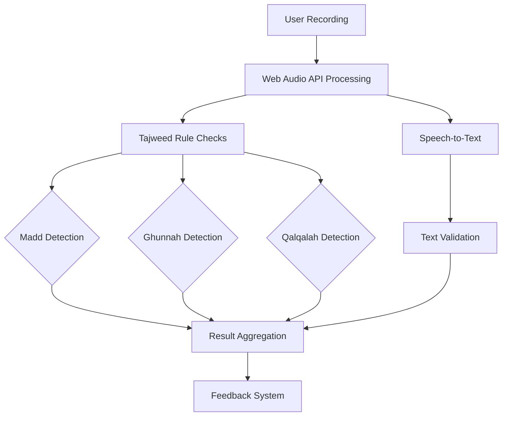
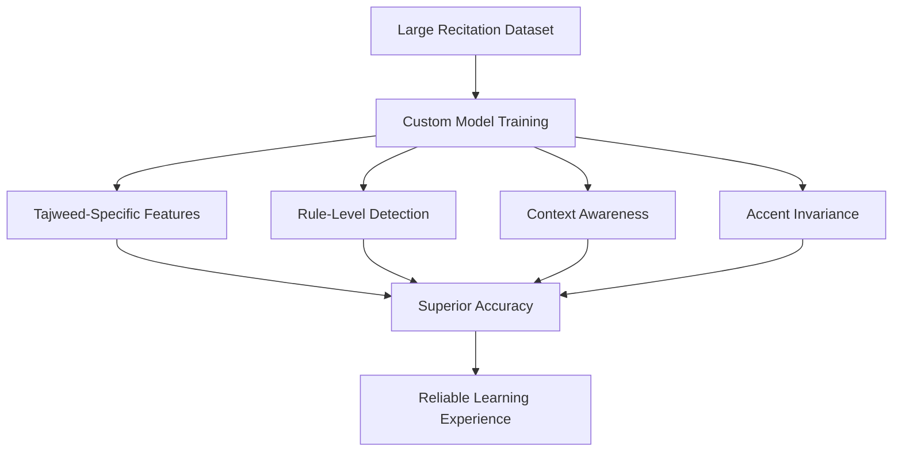
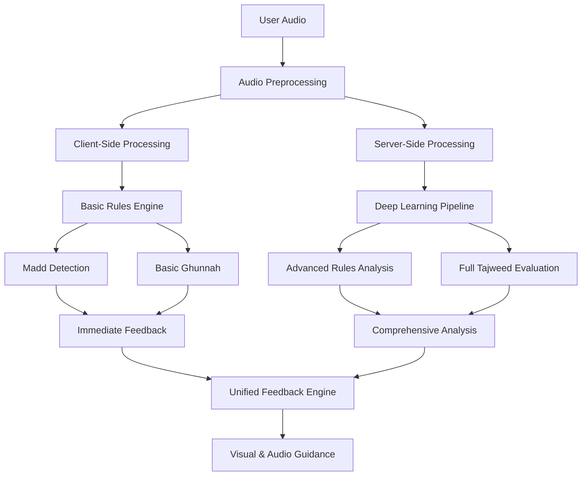
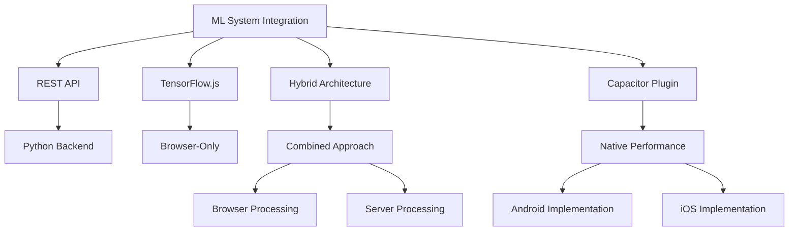

<!-- Copia del documento di progetto claude.ai "Comprehensive Roadmap for AI-Powered Tajweed Recognition System.md" (creato 2025-03-15). Testo originale, non modificato. -->

# AI-Powered Tajweed Recognition System: Comprehensive Roadmap

## 1. Executive Summary

This roadmap outlines the development strategy for implementing an AI-powered Tajweed recognition system that can verify proper application of Tajweed rules in Quranic recitation. The system will leverage both rule-based analysis and machine learning models, with options for using pre-trained models or developing custom models from extensive recitation datasets.

---

## 2. System Overview

### Core Functionality
- **Real-time recognition** of Tajweed rule application
- **High-accuracy verification** of proper pronunciation 
- **Immediate feedback** with visual and audio guidance
- **Progressive learning** that adapts to user proficiency

### Primary Tajweed Rules for Detection
1. **Madd** (elongation): Duration-based analysis
2. **Ghunnah** (nasalization): Spectral feature analysis
3. **Qalqalah** (echo): Transient detection in consonants
4. **Idgham** (merging): Phoneme boundary analysis
5. **Ikhfa** (hiding): Partial nasalization detection

---

## 3. Technical Approaches

### Approach A: Hybrid System (Faster Implementation)



#### Components
- **Tarteel-STT** (or similar) for speech-to-text and verse alignment
- **Web Audio API** for basic audio feature extraction
- **TensorFlow.js models** for client-side inference
- **Rule-based analysis** for simpler Tajweed rules

#### Advantages
- Faster implementation (3-4 months)
- Lower initial development costs
- Combines pre-trained models with rule-based analysis
- Works well for basic Tajweed rules

#### Limitations
- 70-80% accuracy for complex rules
- Limited to rules with clear acoustic signatures
- Higher error rate for non-standard accents

### Approach B: Custom Model System (Higher Accuracy)



#### Components
- **Custom-trained speech recognition** for Quranic recitation
- **Rule-specific ML models** for each Tajweed rule
- **Dual-processing architecture** (client/server)
- **Confidence scoring system** with expert validation

#### Advantages
- 90-95% accuracy for specific rule detection
- Better handling of diverse recitation styles
- More reliable learning experience
- Long-term scalability and improvement

#### Requirements
- 100+ hours of labeled recitation data
- GPU resources for model training
- 6-8 months development timeline
- Higher initial development investment

---

## 4. Implementation Roadmap

### Phase 1: Foundation (8-10 weeks)

#### Technical Goals
- Implement audio capture and processing pipeline
- Deploy basic STT model for verse alignment
- Develop rule-based analysis for Madd detection
- Create initial feedback visualization system

#### Key Deliverables
- Audio recording and processing module
- Basic Tajweed rule detection engine
- Simple visual feedback system
- Integration with existing app infrastructure

### Phase 2: Enhanced Recognition (10-12 weeks)

#### Technical Goals
- Implement or train models for core Tajweed rules
- Develop comprehensive visual feedback system
- Create user progression tracking
- Optimize performance on target devices

#### Key Deliverables
- Complete Tajweed rule detection system
- Comprehensive feedback visualization
- User progress analytics
- Performance optimization for mobile devices

### Phase 3: Advanced Features (8-10 weeks)

#### Technical Goals
- Implement streaming analysis for real-time feedback
- Add adaptive learning based on user performance
- Develop expert validation system
- Fine-tune models with user feedback

#### Key Deliverables
- Streaming inference pipeline
- Adaptive learning system
- Expert validation interface
- Continuous improvement mechanism

---

## 5. Model Development Strategy

### Option A: Pre-trained Model Approach

| Rule Type | Recommended Model | Expected Accuracy | Size |
|-----------|-------------------|------------------|------|
| Verse Alignment | Tarteel-STT or Wav2Vec 2.0 Arabic | 85-90% | 150-300MB |
| Madd | Duration-based analysis + TorchAudio GRU | 80-85% | 50-80MB |
| Ghunnah | OpenSmile + Transfer learning models | 75-80% | 30-50MB |
| Qalqalah | Onset detectors + TF-Signal models | 70-75% | 40-60MB |
| Idgham | Phoneme aligners (MFA) | 65-70% | 80-120MB |

### Option B: Custom Model Development

#### Data Requirements
- **Minimum**: 100+ hours of recitation
- **Optimal**: 500+ hours with diverse reciters
- **Segmentation**: Verse-level and rule-level annotations
- **Balance**: Both correct and incorrect applications

#### Model Architecture Selection

```
┌───────────────────┐  ┌───────────────────┐  ┌───────────────────┐
│   Base Model      │  │   Rule Models     │  │   Ensemble        │
├───────────────────┤  ├───────────────────┤  ├───────────────────┤
│ • Wav2Vec 2.0     │  │ • Madd: TCN       │  │ • Rule Weighting  │
│ • HuBERT          │─→│ • Ghunnah: CNN    │─→│ • Confidence      │
│ • Fine-tuned STT  │  │ • Qalqalah: RNN   │  │   Scoring         │
└───────────────────┘  └───────────────────┘  └───────────────────┘
```

#### Training Process
1. Pre-process and normalize audio data
2. Train base model for verse alignment
3. Develop rule-specific models using transfer learning
4. Implement ensemble approach for comprehensive detection
5. Optimize models for deployment (quantization, distillation)

---

## 6. Technical Architecture

### Client-Side Components

```
┌─────────────────────────────────────────────────────────────┐
│ User Interface                                              │
├─────────────────────────────────────────────────────────────┤
│ ┌─────────────┐ ┌─────────────┐ ┌─────────────────────────┐ │
│ │ Recording   │ │ Visualization│ │ Feedback System        │ │
│ │ Module      │ │ Engine      │ │                         │ │
│ └─────────────┘ └─────────────┘ └─────────────────────────┘ │
├─────────────────────────────────────────────────────────────┤
│ ┌─────────────┐ ┌─────────────┐ ┌─────────────────────────┐ │
│ │ Audio       │ │ Web Workers │ │ Feature Extraction      │ │
│ │ Processing  │ │             │ │                         │ │
│ └─────────────┘ └─────────────┘ └─────────────────────────┘ │
├─────────────────────────────────────────────────────────────┤
│ ┌─────────────┐ ┌─────────────┐ ┌─────────────────────────┐ │
│ │ TensorFlow.js│ │ WebAssembly │ │ Rule Detection Engine  │ │
│ │ Runtime     │ │ Modules     │ │                         │ │
│ └─────────────┘ └─────────────┘ └─────────────────────────┘ │
└─────────────────────────────────────────────────────────────┘
```

### Server-Side Components (Optional for Higher Accuracy)

```
┌─────────────────────────────────────────────────────────────┐
│ API Gateway                                                 │
├─────────────────────────────────────────────────────────────┤
│ ┌─────────────┐ ┌─────────────┐ ┌─────────────────────────┐ │
│ │ Audio       │ │ Model       │ │ User Management         │ │
│ │ Processing  │ │ Serving     │ │                         │ │
│ └─────────────┘ └─────────────┘ └─────────────────────────┘ │
├─────────────────────────────────────────────────────────────┤
│ ┌─────────────┐ ┌─────────────┐ ┌─────────────────────────┐ │
│ │ ONNX Runtime│ │ TensorRT    │ │ GPU Acceleration        │ │
│ │             │ │             │ │                         │ │
│ └─────────────┘ └─────────────┘ └─────────────────────────┘ │
├─────────────────────────────────────────────────────────────┤
│ ┌─────────────┐ ┌─────────────┐ ┌─────────────────────────┐ │
│ │ Analytics   │ │ Model       │ │ Expert Validation       │ │
│ │ Engine      │ │ Retraining  │ │ System                  │ │
│ └─────────────┘ └─────────────┘ └─────────────────────────┘ │
└─────────────────────────────────────────────────────────────┘
```

### Dual Processing Architecture 

For optimal performance and accuracy balance:



---

## 7. Performance Optimization

### Client-Side Optimization

1. **Model Optimization**
   - Quantization to 8-bit precision
   - Model pruning to reduce size by 40-60%
   - Knowledge distillation for smaller, faster models

2. **Computation Efficiency**
   - Web Workers for parallel processing
   - WebGL acceleration for applicable models
   - WebAssembly for critical audio processing functions

3. **Memory Management**
   - Progressive model loading
   - Efficient audio buffer handling
   - Garbage collection optimization

### Real-Time Processing

1. **Streaming Analysis**
   - Process audio in 200ms chunks
   - Sliding window analysis
   - Progressive feedback generation

2. **Low-Latency Architecture**
   - Client-side processing for immediate feedback
   - Pre-loading of expected models
   - Adaptive quality based on device capabilities

---

## 8. Data Preparation Guidelines

### Audio Recording Standards
- **Sample Rate**: 16kHz minimum, 44.1kHz recommended
- **Format**: WAV or FLAC for training, MP3/WebM for deployment
- **Quality**: Low background noise, clear pronunciation
- **Duration**: Individual verses or rule-specific segments

### Annotation Requirements
1. **Transcription Level**:
   - Verse text alignment
   - Word-level timestamps
   - Phoneme-level segmentation (ideal)

2. **Rule Annotations**:
   - Mark starting/ending points of each rule application
   - Classify correctness of application
   - Note specific rule type and subtype

3. **Expert Validation**:
   - Secondary review of annotations
   - Consistency check across multiple experts
   - Quality scoring of example recitations

### Training Data Organization

```
dataset/
├── audio/
│   ├── correct/
│   │   ├── madd/
│   │   ├── ghunnah/
│   │   └── qalqalah/
│   └── incorrect/
│       ├── madd/
│       ├── ghunnah/
│       └── qalqalah/
├── transcriptions/
│   ├── verse_alignments.json
│   ├── word_timings.json
│   └── phoneme_segments.json
└── metadata/
    ├── reciter_info.csv
    ├── rule_annotations.csv
    └── quality_metrics.csv
```

---

## 9. Cost and Resource Considerations

### Development Costs

| Approach | Development Time | Technical Complexity | Initial Investment |
|----------|------------------|----------------------|-------------------|
| Hybrid System | 3-4 months | Medium | $30-50K |
| Custom Models | 6-8 months | High | $80-120K |

### Ongoing Costs

| Component | Hybrid Approach | Custom Approach |
|-----------|-----------------|----------------|
| Client-side Processing | $0 (user device) | $0 (user device) |
| Server Processing | $0.01-0.02/minute | $0.02-0.05/minute |
| Model Retraining | $500-1000/quarter | $1000-2000/quarter |
| Storage & CDN | $50-100/month | $100-200/month |

### Resource Requirements

#### Development Phase
- **Computing**: GPU workstations or cloud instances (A100/V100)
- **Storage**: 1-5TB for raw data and training artifacts
- **Team**: ML engineers, audio specialists, Tajweed experts

#### Deployment Phase
- **Client Devices**: Modern browsers with WebGL support
- **Server**: GPU-enabled instances for advanced rule processing
- **Database**: Structured storage for user progress and analytics

---

## 10. Technical Risks and Mitigations

| Risk | Probability | Impact | Mitigation |
|------|------------|--------|------------|
| Insufficient accuracy for complex rules | Medium | High | Begin with simpler rules, use hybrid approach |
| Performance issues on mobile devices | Medium | High | Progressive enhancement, optimized models |
| Dialect/accent variations affecting accuracy | High | Medium | Diverse training data, adaptive learning |
| Large model sizes affecting load time | Medium | Medium | Progressive loading, model compression |
| Audio quality affecting recognition | High | Medium | Pre-processing, noise reduction techniques |

---

## 11. Angular Integration Strategy

This section outlines how to integrate the Python-based ML system with your Angular/Capacitor application.

### Integration Approaches



#### 1. Hybrid Architecture (Primary Recommendation)

The hybrid approach balances performance and accuracy by processing basic rules in the browser and complex rules on the server:

```
┌───────────────────────────────────────────────┐
│               Angular Application              │
├───────────────────────┬───────────────────────┤
│  TensorFlow.js Models │  Audio Processing     │
│  (Basic rules)        │  (Web Audio API)      │
└─────────┬─────────────┴───────────────────────┘
          │                       ▲
          ▼                       │
┌───────────────────────────────────────────────┐
│               Python API Backend               │
├───────────────────────┬───────────────────────┤
│  Advanced ML Models   │  Complex Rule         │
│  (PyTorch/TensorFlow) │  Processing           │
└───────────────────────┴───────────────────────┘
```

**Implementation:**

```typescript
// Angular service for hybrid Tajweed analysis
export class TajweedService {
  constructor(
    private http: HttpClient,
    private audioProcessor: AudioProcessingService
  ) {}
  
  async analyzeTajweed(audioBlob: Blob, verseId: string): Promise<TajweedAnalysis> {
    // Step 1: Process basic rules in the browser
    const audioBuffer = await this.audioProcessor.convertToAudioBuffer(audioBlob);
    const basicResults = await this.analyzeBasicRulesLocally(audioBuffer, verseId);
    
    // Step 2: Check if advanced analysis is needed and internet is available
    if (navigator.onLine && this.needsAdvancedAnalysis(basicResults)) {
      try {
        // Step 3: Send to server for advanced analysis
        const advancedResults = await this.getAdvancedAnalysis(audioBlob, verseId);
        
        // Step 4: Merge results, prioritizing server results where available
        return this.mergeResults(basicResults, advancedResults);
      } catch (error) {
        console.error('Advanced analysis failed, using basic results', error);
        return basicResults;
      }
    }
    
    return basicResults;
  }
  
  private async analyzeBasicRulesLocally(audioBuffer: AudioBuffer, verseId: string): Promise<TajweedAnalysis> {
    // Use TensorFlow.js models loaded in the application
    // Focus on simple rules like Madd (elongation) that can be detected with timing analysis
    // ...implementation details...
  }
  
  private async getAdvancedAnalysis(audioBlob: Blob, verseId: string): Promise<TajweedAnalysis> {
    const formData = new FormData();
    formData.append('audio', audioBlob, 'recitation.webm');
    formData.append('verseId', verseId);
    
    return this.http.post<TajweedAnalysis>(
      'https://your-tajweed-api.com/analyze', 
      formData
    ).toPromise();
  }
  
  private mergeResults(basicResults: TajweedAnalysis, advancedResults: TajweedAnalysis): TajweedAnalysis {
    // Intelligent merging of results, prioritizing higher confidence scores
    // ...implementation details...
  }
}
```

**Advantages:**
- Works offline for basic functionality
- High accuracy for complex rules when online
- Balanced approach for performance and accuracy
- Progressive enhancement based on connectivity
- Reduced server costs (only processing complex cases)

#### 2. Capacitor Native Plugin (Advanced Approach)

For optimal mobile performance, a custom Capacitor plugin that interfaces with native ML frameworks:

```
Angular App  ⟷  Capacitor  ⟷  Native Plugin (with TensorFlow Lite/CoreML)
```

**Implementation:**

1. Create the plugin structure:

```bash
# Generate a Capacitor plugin
npx @capacitor/cli plugin:generate

# Plugin structure
tajweed-recognizer/
├── android/                      # Android platform code
│   └── src/main/java/.../        # Java implementation with TensorFlow Lite
├── ios/                          # iOS platform code
│   └── Plugin/                   # Swift implementation with CoreML
├── src/                          # TypeScript definitions
│   └── definitions.ts            # Plugin interface
└── package.json                  # Plugin metadata
```

2. Typescript interface:

```typescript
// src/definitions.ts
export interface TajweedRecognizerPlugin {
  analyze(options: {
    audioPath: string;
    verseId: string;
    rules?: string[];  // Specific rules to check
  }): Promise<TajweedAnalysis>;
  
  loadModels(options: {
    modelsPath: string;
  }): Promise<void>;
}
```

3. Angular integration:

```typescript
// In your Angular service
import { Plugins } from '@capacitor/core';
const { TajweedRecognizer } = Plugins;

export class NativeTajweedService {
  async initialize() {
    // Load models on app startup
    await TajweedRecognizer.loadModels({
      modelsPath: 'models/tajweed'
    });
  }
  
  async analyzeRecitation(recordingPath: string, verseId: string): Promise<TajweedAnalysis> {
    try {
      return await TajweedRecognizer.analyze({
        audioPath: recordingPath,
        verseId: verseId,
        rules: ['madd', 'ghunnah', 'qalqalah']
      });
    } catch (error) {
      console.error('Native analysis failed', error);
      // Fall back to hybrid approach
      return this.fallbackAnalysis(recordingPath, verseId);
    }
  }
  
  private async fallbackAnalysis(recordingPath: string, verseId: string): Promise<TajweedAnalysis> {
    // Implement fallback to hybrid approach
    // ...implementation details...
  }
}
```

**Advantages:**
- Best performance on mobile devices
- Full offline capability
- Battery-efficient processing
- Native user experience (haptic feedback, etc.)
- Access to device-specific optimizations

### Implementation Roadmap

Phase 1: Basic Hybrid Integration (8-10 weeks)
- Deploy Python backend API with FastAPI
- Implement basic Tajweed rule detection in Angular
- Create synchronization between client and server processing

Phase 2: Enhanced Mobile Experience (6-8 weeks)
- Develop Capacitor plugin prototype for one platform (Android)
- Optimize models for mobile performance
- Implement progressive enhancement with connectivity detection

Phase 3: Complete Native Integration (8-10 weeks)
- Complete iOS implementation
- Add advanced caching and offline capabilities
- Optimize battery usage and performance

### Technical Considerations

1. **Audio Format Compatibility**
   - Browser: WebM or MP3 (WebAudio API)
   - Server: WAV or FLAC (higher quality for analysis)
   - Mobile: Platform-native formats

2. **Authentication & Security**
   - Secure API endpoints with JWT or API keys
   - Consider privacy implications of audio uploads
   - Implement rate limiting for server resources

3. **Optimizing Data Transfer**
   - Compress audio before sending to server
   - Consider sending only relevant audio segments
   - Use WebSockets for streaming analysis when possible

4. **Fallback Mechanisms**
   - Graceful degradation when offline
   - Local storage for recent analyses
   - Synchronization when connectivity is restored

### Integration Example: Real-Time Feedback Loop

```typescript
// Angular component for interactive Tajweed learning
@Component({
  selector: 'app-tajweed-practice',
  template: `
    <div class="practice-container">
      <app-verse-display [verse]="currentVerse" [highlights]="feedbackHighlights"></app-verse-display>
      
      <div class="recording-controls">
        <button (click)="toggleRecording()" [disabled]="isAnalyzing">
          {{ isRecording ? 'Stop' : 'Start Recording' }}
        </button>
      </div>
      
      <app-feedback-display *ngIf="analysis" [analysis]="analysis"></app-feedback-display>
    </div>
  `
})
export class TajweedPracticeComponent implements OnInit, OnDestroy {
  currentVerse: any;
  isRecording = false;
  isAnalyzing = false;
  analysis: TajweedAnalysis | null = null;
  feedbackHighlights: any[] = [];
  
  private recorder: any;
  private audioChunks: Blob[] = [];
  
  constructor(
    private tajweedService: TajweedService,
    private verseService: VerseService
  ) {}
  
  ngOnInit() {
    this.currentVerse = this.verseService.getCurrentVerse();
    this.setupRecorder();
  }
  
  async toggleRecording() {
    if (this.isRecording) {
      this.stopRecording();
    } else {
      this.startRecording();
    }
  }
  
  private async setupRecorder() {
    try {
      const stream = await navigator.mediaDevices.getUserMedia({ audio: true });
      this.recorder = new MediaRecorder(stream);
      
      this.recorder.ondataavailable = (event: any) => {
        this.audioChunks.push(event.data);
      };
      
      this.recorder.onstop = async () => {
        await this.processRecording();
      };
    } catch (error) {
      console.error('Failed to set up recorder', error);
    }
  }
  
  private startRecording() {
    this.audioChunks = [];
    this.isRecording = true;
    this.recorder.start();
  }
  
  private stopRecording() {
    this.isRecording = false;
    this.recorder.stop();
  }
  
  private async processRecording() {
    this.isAnalyzing = true;
    
    try {
      const audioBlob = new Blob(this.audioChunks, { type: 'audio/webm' });
      
      // Use the hybrid service to analyze the recording
      this.analysis = await this.tajweedService.analyzeTajweed(
        audioBlob, 
        this.currentVerse.id
      );
      
      // Generate visual feedback highlights
      this.feedbackHighlights = this.generateHighlights(this.analysis);
    } catch (error) {
      console.error('Analysis failed', error);
    } finally {
      this.isAnalyzing = false;
    }
  }
  
  private generateHighlights(analysis: TajweedAnalysis) {
    // Convert analysis results to visual highlights
    // ...implementation details...
    return [];
  }
  
  ngOnDestroy() {
    if (this.recorder) {
      if (this.isRecording) {
        this.recorder.stop();
      }
      this.recorder = null;
    }
  }
}
```

---

## 12. Next Steps and Recommendations

### Immediate Next Steps

1. **Audit existing recitation data**
   - Quantity, quality, and diversity assessment
   - Annotation status and completeness
   - Identify gaps in rule coverage

2. **Prototype development**
   - Build audio capture and processing pipeline
   - Test basic rule detection (start with Madd)
   - Validate against expert evaluation

3. **Make architecture decision**
   - Hybrid vs. Custom Model approach
   - Client-only vs. Dual Processing
   - Development timeline and resource allocation

### Final Recommendations

1. **Start with core rules**: Focus initial development on Madd, Ghunnah, and Qalqalah as they have clearer acoustic signatures

2. **Begin with hybrid approach**: Use rule-based analysis with pre-trained models while preparing for custom model development

3. **Implement custom model training if data is sufficient**: If you have 100+ hours of high-quality annotated data, custom models will provide significantly better accuracy

4. **Consider dual-process architecture**: Use client-side processing for immediate feedback and server-side for comprehensive analysis

5. **Adopt incremental deployment**: Release features progressively to gather user feedback and improve the system iteratively

---

## 13. Resources and References

### Open-Source Models and Tools

- [Tarteel-AI](https://github.com/Tarteel-io/tarteel-models) - Quran recitation models
- [Wav2Vec 2.0](https://github.com/facebookresearch/fairseq/tree/main/examples/wav2vec) - Self-supervised speech representation learning
- [TensorFlow.js](https://www.tensorflow.org/js) - ML framework for JavaScript
- [ONNX Runtime](https://onnxruntime.ai/) - Cross-platform inference acceleration
- [WebAudio API](https://developer.mozilla.org/en-US/docs/Web/API/Web_Audio_API) - Audio processing in browsers

### Datasets

- [Tarteel Dataset](https://tarteel.ai/dataset/) - Crowd-sourced Quranic recitations
- [Common Voice Arabic](https://commonvoice.mozilla.org/) - General Arabic speech corpus
- [Quranic Arabic Corpus](https://quranmorph.com/) - Linguistic annotations of the Quran

### Research Papers

- ["Deep Recitation: AI-Based Tajweed Error Detection"](https://arxiv.org/pdf/2103.03974.pdf)
- ["Automatic Recognition of Quranic Recitation Rules"](https://www.sciencedirect.com/science/article/pii/S1877050920304233)
- ["DeepTajweed: A Deep Learning Framework for Automatic Tajweed Rule Recognition"](https://ieeexplore.ieee.org/document/9123074)

---

## 14. Conclusion

Building an AI-powered Tajweed recognition system represents a significant technical challenge, but one with tremendous value for Quran learning. By following this roadmap, you can develop a system that provides accurate, real-time feedback on Tajweed rule application, ensuring learners develop proper recitation habits.

The optimal approach combines rule-based analysis with machine learning models, leveraging your extensive recitation dataset to train custom models for each Tajweed rule. This hybrid strategy balances accuracy, performance, and development time, while providing a path for continuous improvement as more data becomes available.

By implementing this system incrementally, focusing first on the most common rules and gradually expanding to more complex ones, you can deliver immediate value while building toward a comprehensive Tajweed verification platform.
